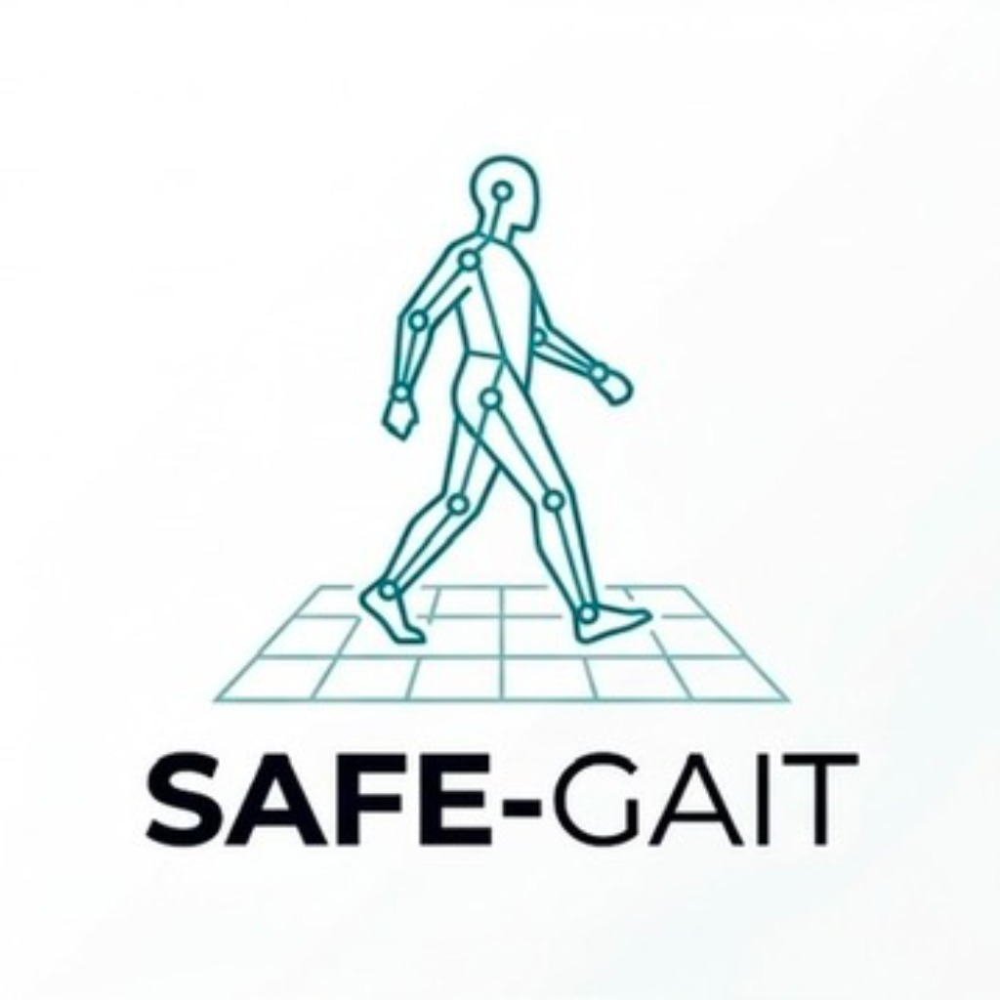

<p align="center"></p>

# SAFE-GAIT: 3D gait analysis on a smartphone

Engineering project at **Télécom Physique Strasbourg** (team of 4 students), for a physician.

## Objective

Give clinicians a simple tool to record a patient's walk and extract their **3D skeleton**, as a basis for
assessing the risk of falling, without a motion-capture lab.

The repository contains:
- an **iOS app** (Swift) that tracks the skeleton in 3D in real time by combining **Google ML Kit** pose
  estimation with the **LiDAR** depth sensor of the iPhone / iPad;
- **Python scripts** to process recorded videos with other approaches (**MediaPipe**, **YOLOv8 + VideoPose3D**).

## How the iOS app works

```
ARKit frame (RGB image + LiDAR depth map)
      │
      ├─► ML Kit pose detection ─► 33 body landmarks in pixels
      │
      └─► depth read at each landmark ─► back-projection with the camera intrinsics (pinhole model)
                                                     │
                                ARKit camera pose ◄──┘
                                       │
                     3D joint positions in the room (metres)
                       ├─► live 3D skeleton on screen (RealityKit)
                       └─► CSV recording: timestamp, joint_name, x, y, z
```

1. The AR session delivers, for each frame, the camera image and the LiDAR depth map.
2. ML Kit detects the body landmarks in the image; landmarks with low confidence (< 0.6) are ignored.
3. For each landmark, the depth is read in the LiDAR map, and the point is back-projected in 3D
   (x = (u − cx)·Z / fx, y = (v − cy)·Z / fy), then placed in the room with the camera pose.
4. The skeleton is drawn live (spheres for the joints, cylinders for the bones).
5. The clinician starts and stops the acquisition, can add notes (cane, fatigue, pain…), and exports the
   CSV and the notes through the iOS share sheet.

## Code organization

```
├── ios-app/
│   ├── SAFE_GAIT2/
│   │   ├── SAFE_GAITApp.swift      # app entry point
│   │   ├── ContentView.swift       # interface: acquisition button, clinical notes, export
│   │   ├── CameraView.swift        # AR view with LiDAR enabled, 3D skeleton rendering
│   │   ├── PoseManager.swift       # ML Kit detection, LiDAR depth, 2D → 3D back-projection, CSV recording
│   │   └── PoseLogger.swift        # first version of the logger (2D landmarks, not used by the app)
│   ├── SAFE_GAIT2.xcodeproj/
│   └── Podfile                     # dependency: GoogleMLKit/PoseDetectionAccurate
│
└── python/
    ├── requirements.txt
    ├── pose-extraction-mediapipe/
    │   ├── extract_pose_mediapipe.py   # video → 33 landmarks (x, y, z, visibility) per frame → CSV
    │   └── animate_skeleton.py         # CSV → interactive 2D/3D skeleton animation with a frame slider
    └── yolo-to-videopose3d/
        └── bridge_yolo_to_vp3d.py      # YOLOv8 2D keypoints (17 COCO joints) → VideoPose3D input (.npz)
```

## Run

**iOS app** (Xcode, CocoaPods, iPhone or iPad with a LiDAR sensor):

```bash
cd ios-app
pod install
open SAFE_GAIT2.xcworkspace   # choose your development team under Signing & Capabilities, then run on the device
```

**Python scripts**:

```bash
pip install -r python/requirements.txt
cd python/pose-extraction-mediapipe
python extract_pose_mediapipe.py walk.mp4 --out walk.csv
python animate_skeleton.py walk.csv

cd ../yolo-to-videopose3d
python bridge_yolo_to_vp3d.py yolo_keypoints.csv walk.mp4   # then run VideoPose3D on the generated .npz
```

## Tech stack

Swift · SwiftUI · ARKit · RealityKit · LiDAR · Google ML Kit · Python · MediaPipe · OpenCV · NumPy · pandas ·
Matplotlib · YOLOv8 · VideoPose3D
